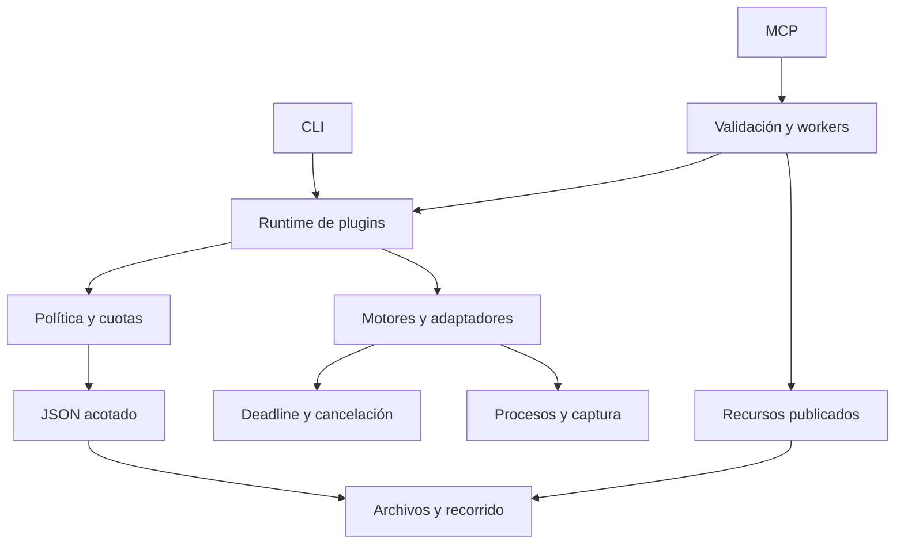

# Arquitectura de ORION Security 2.1.1

## Propósito y separación

ORION ofrece la misma ejecución defensiva a CLI, Python y MCP. La instalación básica usa la biblioteca estándar. El SDK MCP y las herramientas de desarrollo pertenecen a extras independientes. Los proveedores OSINT se integran mediante adaptadores, sin incorporar copias de sus programas.

La arquitectura separa cinco responsabilidades: representación de datos, autorización, ejecución, transporte y publicación documental. El registro de plugins produce el manifiesto; el validador comprueba que el catálogo estático, los esquemas y los entry points coincidan con él.

## Dependencias

`plugins/schema.py` concentra la validación y `plugins/errors.py` las excepciones; `core.py` reexporta sus APIs históricas. `jsonio` y `fileio` no importan plugins ni MCP. Esta dirección permite aplicar la misma validación en scripts, CLI y controles sin dependencias circulares del transporte.

## Contratos de ejecución

`PluginMetadata` identifica un plugin y publica esquemas, permisos declarados y límites. `PluginContext` lleva referencia de autorización, etiqueta del actor, UUID y permisos explícitos. `PluginResult` contiene estado, versión, duración y datos o error.

Los plugins incorporados comprueban autorización incluso en llamadas directas a `.run()`. La admisión del runtime se vincula al plugin, contexto y payload para evitar reutilización y doble consumo de cuota.

La ejecución normal sigue este orden:

1. Resolver el plugin y validar el timeout solicitado.
2. Validar y copiar el payload JSON para que no cambie entre revisión y ejecución.
3. Comprobar su esquema y la política efectiva, incluyendo parada de emergencia.
4. Consumir la cuota de laboratorio cuando corresponde; registrar el inicio.
5. Comprobar disponibilidad y ejecutar dentro del plazo compartido.
6. Validar datos de salida y comprobar cancelación/plazo antes de aceptar éxito.
7. Registrar el resultado y devolver un contrato uniforme.

El timeout general no amplía los límites particulares de procesos o sockets. Las tareas paralelas reciben el contexto de ejecución. Una tarea cancelada no libera su plaza MCP mientras el trabajo siga consumiendo el worker.

## Presupuestos

| Frontera | Límite o regla |
|---|---|
| JSON de aplicación | 1 MiB por defecto, profundidad 32, 20.000 nodos contando claves, enteros de hasta 1.024 dígitos |
| JSON configurable interno | Entre 1 byte y 16 MiB; el consumidor declara el límite |
| HTTP MCP | 1 MiB de cuerpo; 32 KiB / 128 cabeceras; 4.096 fragmentos; 10 segundos para recibir el cuerpo; 64 solicitudes simultáneas |
| Entrada stdio MCP | 1 MiB por mensaje más delimitador; lectura acotada y JSON estricto antes del SDK; cierre ante exceso |
| Salida MCP | 8 MiB contando UTF-8 y contenido estructurado/textual; trama stdio final hasta 8 MiB + 4 KiB |
| Trabajo MCP síncrono | 8 workers y 64 trabajos admitidos; rechazo al saturarse |
| Recurso publicado | 2 MiB por archivo por defecto, configurable hasta 16 MiB |
| Recorrido del catálogo | 10.000 entradas visitadas, profundidad 32; incluye archivos descartados |
| Búsqueda documental | 32 MiB de contenido inspeccionado, consulta de 2 a 512 caracteres, hasta 100 resultados |
| Captura de procesos | 2 MiB por stream stdout/stderr |
| Artefactos externos | 8 MiB, 256 archivos, 4.096 entradas de recorrido, profundidad 16 |
| TLS controlado | 1–16 IPv4 explícitas, 1–4 workers, 0,1–10 segundos por operación de socket |

El límite JSON se aplica antes y durante la serialización; repetir referencias a una cadena grande no permite construir una salida gigantesca antes del rechazo. Se rechazan números no finitos, claves repetidas y Unicode inválido.

La adaptación stdio limita la lectura y escritura de bytes; conserva el servidor y el ciclo de vida del SDK 1.x. Una línea excesiva no se drena ni se reutiliza parcialmente como otro mensaje. Los límites MCP son independientes del tamaño permitido por el catálogo: base64 y la duplicación de contenido pueden hacer que un recurso necesite una versión menor para ser devuelto.

## Procesos y cancelación

`ToolRunner` construye un `argv` validado y siempre usa `shell=False`. Las entradas de usuario no pueden convertirse en opciones adicionales de Sherlock u otros adaptadores. Los ejecutables se resuelven desde configuración del operador; no se admite código arbitrario como payload MCP.

Cada invocación usa un directorio temporal, un entorno filtrado y un presupuesto compartido. La captura de stdout/stderr es acotada; los artefactos se recorren y leen con límites. La redacción evita devolver valores sensibles del entorno y argumentos sensibles en resultados o errores.

En POSIX se crea una sesión dedicada y se limpia su grupo de procesos. En Windows se utiliza un Job Object con terminación al cerrar. Hay límites: un ejecutable hostil puede escapar del grupo POSIX; la asignación al Job Object ocurre después de crear el proceso. Estos mecanismos gestionan herramientas locales confiables; no son un sandbox.

## Archivos y publicación

Las lecturas usan descriptores y `fstat` para verificar el archivo realmente abierto. En POSIX, `dir_fd` y `O_NOFOLLOW` protegen cada componente. En otras plataformas se aplican comprobaciones de enlaces, puntos de reanálisis e identidad; siguen siendo necesarios permisos administrativos sobre los directorios.

El catálogo rechaza traversal, rutas ambiguas, enlaces simbólicos, enlaces físicos y archivos especiales. Codifica caracteres reservados en los URI. Las rutas privadas conocidas y los directorios de evidencia no se publican. Una instalación wheel utiliza sus recursos empaquetados, sin adoptar un directorio de trabajo que parezca un repositorio.

El filtro no detecta todos los secretos: el operador determina qué árbol es publicable. La búsqueda es léxica; no se presenta como búsqueda semántica ni como análisis de vulnerabilidades.

## Modelo de amenazas

| Entrada o actor | Amenaza considerada | Control |
|---|---|---|
| Payload de un agente | Confusión de tipos, JSON excesivo, opciones de CLI | Esquemas estrictos, JSON acotado, validadores por adaptador |
| Documento consultado | Instrucciones para ampliar permisos | Recursos tratados como datos; permisos independientes del contenido |
| Cliente HTTP del navegador | Rebinding, origen inesperado, framing ambiguo | Loopback y reglas exactas compartidas con el SDK |
| Proceso externo confiable que falla | Bloqueo, salida excesiva, descendientes huérfanos | Deadline, captura acotada y limpieza en todas las salidas |
| Cambio de archivos durante lectura | Escape mediante enlaces, crecimiento continuo | Aperturas verificadas y límites sobre bytes realmente leídos |
| Solicitudes TLS concurrentes | Superar el cupo o cambiar el payload aprobado | Huella exacta y transacción SQLite |
| Paquete incompleto o catálogo antiguo | Funciones que desaparecen al instalar | Pruebas de wheel/sdist y comparación completa de manifiestos |

Quedan fuera del aislamiento: administrador hostil, intérprete comprometido, plugins Python arbitrarios o binarios maliciosos. Para esos escenarios se requiere un contenedor o máquina virtual, control de salida de red y permisos del sistema operativo.

## Compatibilidad y evolución

La distribución y los entry points conservan sus nombres. Las restricciones nuevas rechazan datos ambiguos o peligrosos que nunca fueron un contrato seguro: coerciones, claves JSON duplicadas, enlaces y opciones no autorizadas. El SDK mínimo MCP pasa a 1.30 dentro de la familia 1.x.

MCP usa negociación `initialize` del SDK instalado. El inventario `orion_protocol_audit` declara lo observado y las extensiones no implementadas. Los transportes probados no constituyen una certificación de una revisión posterior de MCP.

Consulte [operación controlada](../docs/CONTROLLED_OPERATION.md), [plugins](../docs/PLUGIN_SYSTEM.md), [MCP](../docs/MCP_SERVER.md) y [desarrollo](../docs/DEVELOPMENT.md).
